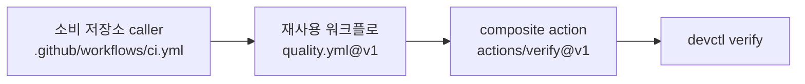

# dev-platform 유지보수 가이드

플랫폼 자체를 고치고, 도구를 올리고, 새 스택이나 새 저장소를 붙이는 절차다. 일상 사용법은 [MANUAL.ko.md](MANUAL.ko.md)에 있다.

## 1. 구조 한눈에 보기

| 저장소 | 역할 |
| --- | --- |
| `ghdtmdwns133/dev-platform` | 재사용 워크플로, composite action, CLI, 템플릿, 문서의 정본. 소비 저장소는 `@v1`로 참조한다. |
| `ghdtmdwns133/dev-flow-py` | Python 샘플. `quality.yml` + `security.yml`을 호출하고 릴리스는 wheel/sdist. |
| `ghdtmdwns133/dev-flow-web` | TypeScript 샘플. Sentry 연동, 릴리스는 `dist.zip`. |
| `ghdtmdwns133/project-delta` | private Unity 프로젝트. `unity.yml`을 self-hosted 러너로 호출한다. |

`dev-platform` 디렉터리의 책임은 다음과 같다.

| 경로 | 책임 |
| --- | --- |
| `cli/src/devplatform/` | `devctl` 구현. `config.py`, `verify.py`, `unity.py`, `integrity.py`, `hooks.py`, `versions.py`, `report.py`, `initcmd.py`, `cloudbuild.py`, `procs.py`, `cli.py` |
| `versions.json` | 도구 버전의 정본. CLI, 워크플로, devcontainer, 문서가 참조한다. |
| `actions/` | `setup-platform`, `verify`, `security-scan`, `notify`, `codecov`, `sentry-sourcemaps`, `unity-cloud-build` |
| `.github/workflows/` | 재사용 워크플로 `quality.yml`, `security.yml`, `unity.yml`, `release.yml`, `nightly.yml`, `auto-merge.yml`과 자체 검증 `self-test.yml` |
| `templates/` | `_shared` + `python`, `typescript`, `dotnet`, `unity` |
| `docs/` | 사용·채택·운영 문서 |
| `scripts/` | `bootstrap.ps1`, `bootstrap.sh` |

호출 방향은 한 방향이다. 소비 저장소의 caller 워크플로가 재사용 워크플로를 부르고, 재사용 워크플로가 composite action을 부르며, composite action이 `devctl`을 실행한다.



## 2. 핵심 원칙

- **단일 검증 계약.** `verify.py`의 `plan()`이 프로필별 단계와 argv의 정본이고, `PREREQUISITES`가 단계 의존성을 정한다. 로컬과 CI는 `devctl verify --profile <p>`를 같은 인자로 실행한다. `verify`는 시작할 때 `<reports>/<profile>/`를 비우고(`_clear_profile_reports`), 선행 단계가 실패하면 의존 단계를 `skipped`로 기록하며 `detail`에 `prerequisite <name> failed`를 남긴다. 단계 이름(`uv-sync`, `pytest`, `unity-integrity`, `coverage` 등)은 `summary.json`과 CI 로그의 계약이므로 이름을 바꾸면 소비자 문서와 테스트도 함께 고친다.
- **버전 정본.** `versions.json`만 고치고 끝내지 않는다. 실제 실행에 쓰이는 값은 워크플로와 action에 하드코딩돼 있는 경우가 많다(4절 참조). `devctl versions --check`는 python 마이너 불일치, dotnet 프로필의 SDK 부재, unity 에디터가 있을 때의 정확한 버전 불일치, 핀보다 낮은 node 메이저를 실패로 보고, uv/npm/보안 도구는 경고로만 본다.
- **SHA 고정.** 서드파티 action은 40자 SHA로 고정하고 뒤에 `# v4` 같은 태그 주석을 단다. `zizmor.yml`은 `ghdtmdwns133/*`만 태그 참조를 허용하고 나머지는 `hash-pin`을 요구한다. 새 action을 추가하면 SHA를 해석해 넣는다.

  ```bash
  gh api repos/actions/checkout/git/ref/tags/v4 --jq .object.sha
  gh api repos/actions/checkout/git/tags/<sha> --jq .object.sha   # annotated 태그면 한 번 더
  ```

- **`v1` 태그.** 소비 저장소의 `uses:`와 `platform-ref`/`ref` 입력은 태그를 가리킨다. 태그가 움직이면 다음 실행부터 새 코드가 쓰인다. 태그가 가리키는 SHA는 [ADOPTION.md](ADOPTION.md)에 기록한다.

## 3. 일상 유지보수 절차

1. `main`에서 브랜치를 만들고 `cli/`나 워크플로를 고친다.
2. 로컬에서 CLI 테스트를 돌린다. 템플릿을 건드렸다면 렌더링 검증도 한다.

   ```bash
   cd C:/dev/dev-platform
   uv run --project cli ruff check cli
   uv run --project cli ruff format --check cli
   uv run --project cli pytest cli/tests -q
   ```

3. push하고 `self-test`가 초록인지 확인한다. `cli`, `templates (*)`, `templates (unity)`, `devcontainer (*)`, `security`, `workflow-lint`가 모두 필요하다.

   ```bash
   gh run list --workflow self-test.yml -L 3
   gh run view <run-id> --log-failed
   ```

4. `main`이 초록이면 annotated 태그를 옮긴다. 초록이 아닌 커밋으로는 옮기지 않는다.

   ```bash
   git switch main && git pull --ff-only
   git tag -f -a v1 -m "platform v1: <변경 요약>" main
   git push origin refs/tags/v1 --force
   git rev-list -n 1 v1
   ```

5. 소비 저장소를 다시 돌려 새 태그를 소비했는지 확인한다.

   ```bash
   gh workflow run ci.yml -R ghdtmdwns133/dev-flow-py
   gh workflow run ci.yml -R ghdtmdwns133/project-delta
   gh run list -R ghdtmdwns133/project-delta -L 3
   ```

**`v2`를 만드는 기준.** 다음 중 하나라도 해당하면 `v1`을 옮기지 않고 `v2`를 새로 만든 뒤 소비 저장소를 순차 이전한다.

- 재사용 워크플로 입력 이름·기본값·시크릿 이름이 바뀐다(`unity-runner`, `platform-ref`, `build`, `release-type` 등).
- 프로필 이름이 바뀌거나 없어진다(`PROFILES`).
- `.devplatform/config.json` 키가 바뀐다. 알 수 없는 키는 exit 2로 거부하므로 구버전 config가 깨진다.
- 종료 코드 의미, `summary.json` 필드, 산출물 경로, 아티팩트 이름(`reports-<profile>`, `security-reports`)이 바뀐다.
- `devctl` 서브커맨드나 필수 인자가 바뀐다.

`v2`를 만든 뒤에도 `v1`은 마지막 호환 커밋에 그대로 둔다. 소비 저장소가 옮겨진 것을 확인한 다음에만 정리한다.

## 4. 도구·액션 업데이트

**Dependabot PR.** `github-actions` 생태계 PR은 SHA와 뒤의 태그 주석을 함께 갱신한다. merge 전에 SHA가 실제 태그를 가리키는지 확인한다. auto-merge caller가 있는 저장소에서는 patch/minor가 자동 병합 대상이고, major는 항상 직접 본다. `versions.json`의 `actions` 값은 사람이 읽는 태그이므로, 태그가 바뀌면 같이 고친다.

**보안 도구.** 아래 위치가 모두 같은 값을 가져야 한다.

| 도구 | 고칠 위치 |
| --- | --- |
| trivy | `versions.json` `security.trivy`, `actions/security-scan/action.yml`의 `TRIVY_VERSION` |
| gitleaks | `versions.json` `security.gitleaks`, `actions/security-scan/action.yml`의 `GITLEAKS_VERSION` |
| zizmor | `versions.json` `security.zizmor`, `actions/security-scan/action.yml`의 `uvx zizmor==1.31.1`, `.github/workflows/self-test.yml`의 같은 핀 |
| actionlint | `versions.json` `security.actionlint`, `actions/security-scan/action.yml`과 `.github/workflows/self-test.yml`의 `rhysd/actionlint:1.7.7` |

`devctl versions --check`는 이 도구들을 경고로만 보고하므로, 올린 뒤에는 `self-test`의 `workflow-lint`와 `security`가 통과하는지 직접 확인한다.

**Unity 에디터.** 버전을 올릴 때 다음을 함께 바꾼다.

- `versions.json`의 `unity.version`
- `cli/src/devplatform/config.py`의 `DEFAULT_UNITY["version"]`
- 소비 저장소 `.devplatform/config.json`의 `unity.version`과 `ProjectSettings/ProjectVersion.txt`의 `m_EditorVersion`
- `.github/workflows/unity.yml`의 `unity-version` 기본값
- caller `ci.yml`의 `unity-version`과 템플릿 `templates/unity/.devplatform/config.json`, `templates/unity/.github/workflows/ci.yml`
- UBA를 쓴다면 대시보드의 build target 에디터 버전
- `cli/tests/support.py`의 기본 버전과 버전 문자열을 단정하는 테스트

**Python/Node/.NET.** `versions.json` 외에 다음이 하드코딩돼 있다.

- `python-version: "3.12"`: `actions/setup-platform`, `actions/verify`, `actions/security-scan`, `actions/unity-cloud-build`, `.github/workflows/nightly.yml`, `release.yml`, `self-test.yml`, `unity.yml`
- `node-version: "22"`: `actions/verify`, `release.yml`, `nightly.yml`, `self-test.yml`
- devcontainer 이미지 태그: `templates/python/.devcontainer/devcontainer.json`, `templates/typescript/.devcontainer/devcontainer.json`, `templates/dotnet/.devcontainer/devcontainer.json`
- TypeScript 템플릿의 `.prettierignore`는 `CHANGELOG.md`를 제외한다. release-please가 만드는 파일이 `prettier --check .`를 깨지 않게 하려는 것이므로, 새 스택 템플릿에도 같은 제외를 넣는다.
- .NET: `templates/dotnet/global.json`, `templates/dotnet/Directory.Build.props`의 `TargetFramework`, `versions.json`의 `dotnet.sdk`·`targetFramework`

## 5. 새 스택 추가 (Go 예시)

Rust도 같은 순서다. 각 단계의 파일과 이름은 현재 소스 기준이다.

1. **프로필 등록.** `cli/src/devplatform/config.py`의 `PROFILES`에 `"go"`를 넣는다. 이 값이 `devctl verify --profile`과 `devctl versions --profile`의 argparse 선택지가 된다. Unity처럼 별도 설정 블록이 필요하면 `DEFAULT_UNITY` 같은 기본 dict와 `_validate_*` 함수를 추가하고 `TOP_LEVEL_KEYS`도 넓힌다.
2. **단계 표.** `cli/src/devplatform/verify.py`의 `plan()`에 `elif profile == "go":` 분기를 넣고 `Step(name, "run", argv)`를 순서대로 만든다. 최소 구성은 `go build ./...`, `go vet ./...`, `go test ./... -coverprofile=artifacts/reports/go/coverage.out -covermode=atomic`이다.
   - `Step`의 첫 인자가 `summary.json`의 단계 이름이고, 로그는 `<reports>/go/<name>.log`에 남는다.
   - `gofmt -l .`은 위반이 있어도 exit 0이라 `run` 단계로는 게이트가 되지 않는다. `gofmt -l`의 출력을 검사하는 새 `kind`를 만들거나, 종료 코드를 만들어 주는 래퍼를 `run`에 넣는다.
3. **커버리지.** `plan()`의 커버리지 단계는 `Step("coverage", "coverage", coverage_kind="go")`로 추가한다. 이어서 `COVERAGE_PRODUCERS`에 `"go": "go-test"`(테스트 단계 이름과 동일), `_coverage_value()`에 `kind == "go"` 분기(Go cover profile 파서)를 넣는다. Cobertura가 아니므로 `report.cobertura_line_rate`를 재사용할 수 없다. 파서는 `cli/src/devplatform/report.py`에 두고, 테스트 수 집계는 `_run_test_counts()`에 분기를 더한다. Go는 JUnit을 직접 만들지 않으므로 `go test -json`을 파싱하거나 `gotestsum --junitfile` 같은 도구를 단계에 넣고 `report.junit_counts`를 쓴다.
4. **pre-commit 훅.** `cli/src/devplatform/hooks.py`의 `_plan()`에 `elif profile == "go":` 분기를 넣는다. staged `.go` 파일에 `gofmt -l`(출력 검사)을 걸거나 패키지 단위 `go vet ./...`을 쓰되, 훅은 10초 안에 끝나야 한다. 훅은 Unity 에디터를 절대 실행하지 않는다.
5. **버전 계약.** `versions.json`에 `"go": {"version": "1.23"}` 같은 블록을 넣고, `cli/src/devplatform/versions.py`의 `check_versions()`에 새 `Check`를 추가한다. 검사는 `_parts()`와 `_simple()` 또는 전용 함수를 쓴다. 실패로 볼지 경고로 볼지 정하고 `report_checks()`의 동작과 문서를 맞춘다.
6. **템플릿 등록.** `cli/src/devplatform/initcmd.py`의 `TEMPLATE_PROFILES`에 `"go": ("go", 80)`을 넣는다(값은 `(프로필, 기본 커버리지)`). `templates/go/`를 만들고 `templates/_shared`가 먼저 복사된다는 점을 기억한다. 치환 토큰은 `__PROJECT_NAME__`, `__PROJECT_SLUG__`, `__PACKAGE__`, `__OWNER__`, `__PLATFORM_REF__`, `__PROFILE__`, `__MIN_COVERAGE__`, `__ENABLE_CODECOV__`, `__UPLOAD_SARIF__`이고, 남으면 `init`이 중단한다.
7. **CI 툴체인.** `actions/verify/action.yml`에 `if: inputs.profile == 'go'`인 `actions/setup-go` 단계를 추가한다. `quality.yml`의 "Resolve coverage report path" `case`에 `go)`를 추가해 Codecov 입력 파일을 정한다. `.devcontainer/devcontainer.json`은 Go devcontainer 이미지로 만들고 `ghcr.io/va-h/devcontainers-features/uv:1` feature를 유지한다(CLI가 uv로 돌기 때문).
8. **Dependabot.** `templates/go/.github/dependabot.yml`에 `gomod` 생태계를 추가한다. 기존 템플릿은 `uv`, `npm`, `nuget`, `github-actions`를 쓴다. 그룹은 minor/patch 한 PR, major 별도, `open-pull-requests-limit: 5`를 유지한다.
9. **자체 검증.** `.github/workflows/self-test.yml`의 `templates`와 `devcontainer` matrix에 `go`를 넣고, `templates` 작업에 setup-go 단계를 추가한다. `DEVCONTAINER_CLI`는 `@devcontainers/cli@0.89.0`으로 고정돼 있고 `versions.json`의 `tools.devcontainerCli`와 같아야 한다. `templates (unity)`는 별도 작업이므로 건드리지 않는다.
10. **테스트.** `cli/tests/test_verify.py`에 `plan()`의 argv를 단정하는 테스트를 추가한다(기존 `test_python_plan_argv` 형식). `cli/tests/fixtures/gates/`에 `go-bad`(빌드 실패 + 포맷 위반)를 넣고 `cli/tests/test_gates.py`에 exit 1과 기대 문구를 단정하는 케이스를 추가한다.
11. **문서.** `README.md`의 Profiles 표, `docs/VERIFY.md`의 프로필·단계 이름, `docs/ADOPTION.md`, 이 문서와 [MANUAL.ko.md](MANUAL.ko.md)의 표를 함께 갱신한다.

## 6. 새 저장소에 붙이기

템플릿으로 시작하려면 `devctl init --template <t> --name <n> --dest <path>`를 쓴다. 기존 저장소는 네 가지를 직접 넣는다.

1. `.devplatform/config.json` — `profile`은 필수, 나머지는 기본값이 있다. 알 수 없는 키는 오타로 간주해 exit 2로 거부한다.
2. 루트 `zizmor.yml` — 소유자를 실제 값으로 넣는다. `devctl init`은 `templates/_shared/zizmor.yml`을 렌더링해 이 파일을 만든다.

   ```yaml
   rules:
     unpinned-uses:
       config:
         policies:
           "ghdtmdwns133/*": any
           "*": hash-pin
   ```

3. caller 워크플로 — `quality.yml` 또는 `unity.yml`과 `security.yml`을 부르고, 작업 이름을 `platform-verify`, `platform-security`로 고정한다. PR에서는 `needs`를 두지 않는다.
4. 저장소 설정과 ruleset — 아래 명령을 실행한다.

```bash
gh api -X PATCH repos/ghdtmdwns133/<repo> -F allow_auto_merge=true -F delete_branch_on_merge=true
gh api -X PUT repos/ghdtmdwns133/<repo>/actions/permissions/artifact-and-log-retention -F days=14
gh api -X PUT repos/ghdtmdwns133/<repo>/actions/permissions/workflow \
  -f default_workflow_permissions=read -F can_approve_pull_request_reviews=true
gh api -X PUT repos/ghdtmdwns133/<repo>/vulnerability-alerts
```

`can_approve_pull_request_reviews=true`는 release-please가 `GITHUB_TOKEN`으로 Release PR을 만들기 위해 필요하다. 기본 권한은 read로 둔다. 비밀은 Doppler의 `<repo>/ci` config를 GitHub Actions secrets로 동기화하거나 `gh secret set <NAME> -R ghdtmdwns133/<repo>`로 넣고, 값은 저장소에 커밋하지 않는다.

첫 초록 실행 뒤 실제 체크 이름을 확인하고 `platform-gates` ruleset을 만든다. 재사용 워크플로의 체크는 `platform-verify / verify`처럼 작업 이름이 붙는다.

```bash
gh api repos/ghdtmdwns133/<repo>/commits/main/check-runs --jq '[.check_runs[].name] | unique'
gh api -X POST repos/ghdtmdwns133/<repo>/rulesets --input - <<'JSON'
{
  "name": "platform-gates",
  "target": "branch",
  "enforcement": "active",
  "conditions": { "ref_name": { "include": ["~DEFAULT_BRANCH"], "exclude": [] } },
  "bypass_actors": [
    { "actor_id": 5, "actor_type": "RepositoryRole", "bypass_mode": "always" }
  ],
  "rules": [
    { "type": "non_fast_forward" },
    { "type": "required_status_checks", "parameters": {
      "strict_required_status_checks_policy": false,
      "required_status_checks": [
        { "context": "platform-verify / verify" },
        { "context": "platform-security / scan" }
      ] } }
  ]
}
JSON
```

Unity 저장소는 `platform-verify / integrity`와 `platform-verify / tests`를 넣는다. `notify` 작업은 절대 넣지 않는다. 같은 이름의 ruleset이 있으면 `gh api -X PUT repos/ghdtmdwns133/<repo>/rulesets/<id>`로 갱신한다. `docs/**`만 바꾼 PR은 `paths-ignore` 때문에 체크가 없으므로 소유자 bypass로 병합하거나 코드를 섞는다.

## 7. Unity 운영

**러너.** `project-delta` 전용 repository-level 러너를 `C:/ghr/runner`에 두고 work folder는 `C:/ghr/work`다. 등록 레이블은 `self-hosted`, `Windows`, `X64`, `unity`이고 job은 `runs-on: [self-hosted, windows, unity]`로 잡는다(레이블 비교는 대소문자를 구분하지 않는다). named-user 라이선스를 쓰려면 서비스가 아니라 로그온 사용자로 실행하고, 자동 시작은 Startup 폴더의 `github-runner-project-delta.cmd`가 맡는다(관리자 권한이 필요한 `schtasks`는 쓰지 않는다). 공개 저장소에는 절대 등록하지 않는다.

```bash
gh api -X POST repos/ghdtmdwns133/project-delta/actions/runners/remove-token --jq .token
C:\ghr\runner\config.cmd remove --token <token>
```

러너는 새 버전이 나오면 기본 설정에서 스스로 업데이트하고, 실행 중인 job이 끝난 뒤 적용한다. 적용 여부는 `C:/ghr/runner/_diag/` 로그에서 확인한다.

self-hosted 작업의 checkout은 `clean: false`라서 work folder의 `Library/`가 남고, 다음 실행이 증분 임포트로 빨라진다. `Library/`를 지우는 경우는 Unity 버전을 올렸거나 손상됐다고 판단될 때뿐이고, 그 다음 실행은 전체 재임포트로 느려진다.

**external GUID 베이스라인.** 패키지를 추가·제거했거나 Unity를 올려 `Library/PackageCache`가 바뀌면 갱신한다. `--write-baseline`은 `Assets`, `Packages`, `Library/PackageCache`의 `.meta`를 인덱싱하고, 이미 풀리지 않는 참조는 `"unresolved"`로 동결한다. `Library/PackageCache`가 없으면 exit 2로 거부한다.

```bash
uv run --project C:/dev/dev-platform/cli devctl unity integrity --write-baseline
```

**무결성 규칙.** 검사 순서와 문구는 `cli/src/devplatform/integrity.py`에 있다. 경로 목록은 `REQUIRED_PATHS`, 참조 확장자는 `REFERENCE_SUFFIXES`, 씬·오브젝트 검사는 `_check_scene()`·`_check_required_objects()`, 스크립트 위치는 `_check_scripts()`, 메타/GUID는 `_check_metas()`, 참조는 `_check_references()`다. `::error::` 문구는 CI와 테스트가 소비하므로 바꾸면 `cli/tests/test_integrity.py`를 같이 고친다. 규칙을 저장소별로 바꾸려면 config 키(`requiredObjects`, `allowedScriptRoots`, `templateScripts`, `externalGuidBaseline`, `testPlatforms`)를 우선 사용한다.

**UBA.** 대시보드에서 GitHub 저장소를 연결하고 Windows build target을 만든 뒤 org id, project id, target id, API key를 시크릿 `UNITY_BUILD_API_KEY`, `UNITY_BUILD_ORG_ID`, `UNITY_BUILD_PROJECT_ID`로 넣는다. `unity.cloudBuild.target`과 `unity.cloudBuild.timeoutMinutes`(기본 90)로 기본값을 정한다. 무료 한도는 Windows 200분/월이다.

## 8. 고장 대응 플레이북

**CI 실패 로그.** 실패한 단계만 보려면 `gh run view <run-id> --log-failed`. 아티팩트 `reports-<profile>`에는 `summary.json`, `summary.md`, 단계별 로그가 있으므로 로컬 재현 없이도 마지막 20줄 밖의 원인을 볼 수 있다.

```bash
gh run download <run-id> -n reports-unity -D artifacts/ci-reports
```

**self-test 실패 순서.** `cli`가 깨지면 나머지는 의미가 없으므로 먼저 본다. 다음은 `templates (python|typescript|dotnet|unity)`, 그다음 `devcontainer`, `security`, `workflow-lint` 순으로 확인한다. `templates`는 `devctl init`으로 렌더링한 뒤 `devctl verify`를 돌리므로, 실패는 대개 템플릿 누락 파일이나 미치환 토큰이다. `devcontainer` 실패는 이미지 태그나 `uv` feature 문제다. `workflow-lint`는 zizmor/actionlint이므로 새 action의 SHA 고정 누락이 흔한 원인이다.

**태그를 잘못 옮겼을 때.** 이전 커밋으로 되돌린다. 소비 저장소는 다음 실행부터 되돌아간 코드를 쓴다.

```bash
git tag -f -a v1 -m "platform v1: rollback" <previous-sha>
git push origin refs/tags/v1 --force
git rev-list -n 1 v1
```

태그를 완전히 지우고 다시 만들려면 `git push origin :refs/tags/v1` 후 `git tag -a v1 -m "platform v1" <sha>`와 `git push origin v1`을 실행한다.

**체크 이름이 바뀌어 PR이 막힐 때.** 작업 이름을 바꿨다면 ruleset의 `required_status_checks`가 옛 이름을 가리킨다. 실제 이름을 다시 확인해 ruleset을 `PUT`으로 갱신한다.

**릴리스가 예상 시점에 생기지 않을 때.** release 잡은 Release PR을 승인하고 `merge-wait-minutes`(기본 15)만큼만 기다린다. 초과하면 `::notice::`로 끝나므로 다음 `main` push나 매일 `23 4 * * *` schedule까지 기다린다. `merge-wait-minutes: 0`인 저장소는 이 대기를 아예 하지 않는다. release-please PR이 `main`과 충돌하면 `always-update: true`가 rebase하지만, 충돌이 계속되면 PR을 손으로 갱신한다.

**릴리스는 있는데 자산이 없을 때.** 자산 빌드만 실패한 경우(PC 꺼짐, 러너 오프라인)는 `rebuild-tag`로 복구한다. `release-please` 잡은 태그 존재를 `gh release view`로 확인한 뒤 release-please·자동 병합·대기 단계를 모두 건너뛰고, `release_created=true`, `tag_name=<rebuild-tag>`로 build/publish를 실행한다. publish는 `gh release upload --clobber`로 기존 자산을 교체한다.

```bash
gh workflow run release.yml -R ghdtmdwns133/project-delta --ref main -f rebuild-tag=project-delta-v0.1.0
```

## 9. 알려진 제약

- **Unity 학생 라이선스.** 보유 라이선스는 named-user Student라 시리얼도 `.ulf`도 없다. GameCI v4가 지원하는 활성화 방식이 아니고, Unity Editor Software Terms §2.8은 서드파티가 클라우드/원격 서버에서 에디터를 실행하는 것을 금지한다. 그래서 GitHub 호스팅 러너에서 Unity를 돌리는 경로는 `unity-runner: gameci`로 구현만 되어 있고 기본값이 아니다.
- **gitleaks 전체 히스토리.** `actions/security-scan`은 `gitleaks git .`을 `fetch-depth: 0` 체크아웃에서 실행한다. 과거 커밋의 비밀도 계속 잡히며, 비밀을 교체해도 히스토리에 남아 있으면 빨간색이 유지된다. 브랜치 삭제는 그 커밋이 기본 브랜치 히스토리에 없을 때만 효과가 있다.
- **`GITHUB_TOKEN` PR.** `GITHUB_TOKEN`으로 만든 PR은 `pull_request` 워크플로를 트리거하지 않는다. release-please의 Release PR이 그렇기 때문에 `release.yml`이 `gh workflow run <ci-workflow> --ref <branch>`로 CI를 대신 dispatch한다. 그 실행은 `action_required`로 시작하므로 `actions: write`로 승인하고, 최대 `merge-wait-minutes` 동안 병합을 기다린 뒤 같은 실행에서 release-please를 다시 돌린다. `workflow_run`은 `GITHUB_TOKEN` 실행 뒤에 억제되므로 이 경로가 필요하다.
- **docs-only push.** caller와 `self-test.yml`은 `paths-ignore: [docs/**, "**/*.md"]`라서 문서만 바꾸면 CI가 생기지 않는다. 필수 검사가 있는 저장소에서는 소유자 bypass로 병합하거나 코드 변경을 섞어야 한다.
- **Windows 전용 Unity 실행.** `devctl`의 에디터 탐색은 `unity.editorPath`, `UNITY_EDITOR_PATH`, `C:/Program Files/Unity/Hub/Editor/<version>/Editor/Unity.exe` 순서다. PlayMode는 `unity.playmodeMode: "gui"`에서 창을 열고 입력을 주입하므로 데스크톱이 필요하다. `unity-assets`만 에디터 없이 어디서나 돈다.
- **버전 검사의 강도.** `devctl versions --check`는 uv/npm/trivy/gitleaks/zizmor/actionlint 불일치를 경고로만 보고한다. 이 도구들의 실제 핀은 워크플로와 action에 있으므로 `versions.json`만 고쳐서는 CI 동작이 바뀌지 않는다.
- **self-hosted 러너의 `bash`.** Windows self-hosted 러너에서 `bash`는 WSL bash로 해석된다. 그 러너에서 실행될 수 있는 단계에는 `shell: bash`를 추가하지 말고 `pwsh`를 쓰거나 `shell`을 생략해 러너 기본값을 쓴다. self-hosted Unity 작업과 `release.yml`의 Windows 빌드 분기가 이 규칙을 따른다.
- **Azure 미사용.** 검증과 빌드는 GitHub 호스팅 러너, Unity용 self-hosted PC, Unity Build Automation만 쓴다. Azure 리소스는 만들지 않는다.
