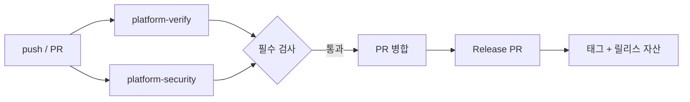

# dev-platform 사용설명서

매일 쓰는 절차만 모았다. 명령 레퍼런스는 [VERIFY.md](VERIFY.md), 새 저장소 연결은 [ADOPTION.md](ADOPTION.md), 플랫폼 자체를 고치는 방법은 [MAINTAINING.ko.md](MAINTAINING.ko.md)에 있다.

## 1. push하면 무엇이 자동으로 일어나는가

push나 PR에서 `platform-verify`와 `platform-security`가 동시에 시작된다. 둘은 서로를 기다리지 않으므로 결함이 있으면 두 검사가 같이 빨간색이 된다.

- 비-Unity 저장소: `platform-verify`가 `ci.yml`을 호출해 `check`와 `test`를 돌린다. 검사 이름은 `platform-verify / check`, `platform-verify / test`다.
- Unity 저장소(`project-delta`): `platform-verify`가 `unity.yml`을 호출해 `platform-verify / integrity`, `platform-verify / tests`를 만들고, `platform-check`가 `ci.yml`을 `run-tests: false`로 호출해 `platform-check / check`를 만든다. `platform-verify / check`는 생기지 않는다.
- `platform-security`는 모든 저장소에서 trivy·gitleaks·zizmor·actionlint를 돌리고 `platform-security / scan`을 만든다.
- `main`에 병합되면 release-please가 Release PR을 열고, 그 PR이 병합되면 태그와 릴리스 자산이 만들어진다.
- Renovate 앱은 사용자가 모든 저장소에 설치했다고 확인했다(2026-10-24). 실제 봇 실행/PR 증거는 아직 확인 전이다. PR이 열리면 병합 가능 여부는 ruleset `platform-gates`의 필수 검사가 결정한다.



## 2. 매일 하는 일

### 2.1 commit

생성된 저장소에는 `.pre-commit-config.yaml`이 들어 있다. bootstrap이 새 저장소에서 `mise trust`/`mise install`과 pre-commit 훅 설치를 자동으로 수행한다. 새로 clone한 저장소는 git 훅을 상속하지 않으므로 그때만 한 번 직접 설치한다. staged 파일만 검사하려면 훅을, 전체 파일을 검사하려면 `mise run check`를 쓴다.

```bash
# 새 clone에서 한 번
mise trust && mise install
mise run prepare
mise exec -- pre-commit install

# 이후
mise run check
```

`project-delta`에는 같은 훅 설치를 감싼 `mise run hooks` 태스크도 있다. 생성 템플릿에는 이 태스크가 없으므로 `mise exec -- pre-commit install`을 쓴다.

| 스택 | check가 실행하는 것 |
| --- | --- |
| `python` | ruff check, ruff format |
| `typescript` | eslint, prettier, tsc |
| `dotnet` | dotnet format |
| `unity` | 공통 pre-commit 훅과 Unity 무결성 검사(에디터 불필요) |

`mise run check`는 모든 파일에 pre-commit을 돌리므로 Unity 무결성 훅도 실행된다. staged 파일만 검사하는 `pre-commit install` 훅은 `Assets/`, `Packages/`, `ProjectSettings/`, `.devplatform/` 중 하나라도 바뀌면 Unity 무결성 검사를 돌린다. 비-Unity에서 `check`는 CI의 `platform-verify / check`와 같은 설정이고, Unity에서는 CI의 `platform-verify / integrity`가 같은 종류의 무결성 검사를 별도로 실행한다. 실패하면 `mise run check`를 직접 다시 돌려 전체 출력을 본다. `--no-verify`로 건너뛸 수는 있지만 CI가 같은 검사를 더 넓게 실행하므로 실패를 미루는 것뿐이다.

### 2.2 push하고 결과 보기

```bash
git push -u origin HEAD
gh run list -L 5
gh run view <run-id> --log-failed
gh pr checks <pr-number>
```

필수 검사 이름은 저장소 종류마다 다르다.

| 저장소 | 필수 검사 |
| --- | --- |
| `python`, `typescript`, `dotnet` | `platform-verify / check`, `platform-verify / test`, `platform-security / scan` |
| `other` 기본(`run_tests: false`) | `platform-verify / check`, `platform-security / scan` |
| `other` + 실제 테스트 태스크(`run_tests: true`) | `platform-verify / check`, `platform-verify / test`, `platform-security / scan` |
| 신규 Unity(`unity-runner: none`, 기본) | `platform-verify / integrity`, `platform-security / scan` |
| private Unity(`unity-runner: self-hosted`) | `platform-verify / integrity`, `platform-verify / tests`, `platform-security / scan` |
| Unity UBA(`unity-runner: uba`) | `platform-verify / integrity`, `platform-security / scan` |
| `project-delta` | `platform-check / check`, `platform-verify / integrity`, `platform-verify / tests`, `platform-security / scan` |
| `dev-platform` | `self-test.yml`이 만드는 작업 이름을 첫 초록 실행 뒤 `gh api .../check-runs`로 확인해 사용한다 |

새 Unity 렌더는 EditMode 전용이며 `unity-runner: none`이 기본이다. 러너가 없는데 `platform-verify / tests`를 필수로 넣거나 self-hosted 작업을 큐에 넣으면 안 된다. public 저장소에는 self-hosted를 등록할 수 없다.

Unity 저장소에 `platform-verify / check`를 넣으면 그 검사는 영원히 나타나지 않아 모든 PR이 막힌다. Unity에서 `mise run check`를 CI에서도 쓰려면 `ci.yml`을 `run-tests: false`로 호출하는 `platform-check` 작업을 따로 두고 그 이름(`platform-check / check`)을 필수 검사에 넣는다. `notify` 작업도 필수 검사에 넣지 않는다.

### 2.3 실패 이슈(`ci-alert`)

실패하면 `notify` 작업이 `ci-alert` 라벨의 이슈를 만들거나 같은 제목의 열린 이슈에 코멘트를 단다. 본문에는 워크플로, 작업, 커밋, 실행 URL, 실패한 단계와 로컬 재현 명령이 들어 있다. 이슈는 자동으로 닫히지 않으므로 수정이 `main`에 들어간 것을 확인하고 직접 닫는다. 다음 실패는 새 이슈가 아니라 같은 이슈에 코멘트로 붙는다.

```bash
gh issue list --label ci-alert
cd C:/dev/<repo>
mise run check
mise run test
```

Unity 저장소는 마지막 두 명령 대신 다음을 쓴다.

```bash
cd C:/dev/project-delta
uv run --project C:/dev/dev-platform/cli devctl verify --profile unity
```

## 3. 로컬 검증

로컬과 CI는 같은 명령을 실행한다. 비-Unity 저장소는 `mise` 태스크가, Unity는 `devctl`이 그 인터페이스다. `C:/dev/dev-platform`은 clone 위치에 맞게 바꾼다.

| 스택 | 명령 | 산출물 |
| --- | --- | --- |
| `python` | `mise run check`, `mise run test` | `coverage/coverage.xml`, `dist/`(빌드) |
| `typescript` | `mise run check`, `mise run test` | `coverage/coverage-final.json`, `coverage/lcov.info`, `dist/` |
| `dotnet` | `mise run check`, `mise run test` | `coverage/coverage.cobertura.xml`, `dist/` |
| `unity` | `devctl verify --profile unity` | `artifacts/reports/unity/` |
| `unity-assets` | `devctl verify --profile unity-assets` | `artifacts/reports/unity-assets/` |
| `other` | `mise run check` | — |

`mise run`은 없는 도구를 먼저 설치한다. `unity-assets`는 무결성만 검사하므로 에디터 없이 어디서나 돈다.

```bash
# 비-Unity
mise run check
mise run test
mise run build          # 릴리스 자산이 필요할 때

# Unity
uv run --project C:/dev/dev-platform/cli devctl verify --profile unity
uv run --project C:/dev/dev-platform/cli devctl verify --profile unity-assets
uv run --project C:/dev/dev-platform/cli devctl summary
```

`devctl verify`는 시작할 때 `<reports>/<profile>/`를 비우므로 이전 실행의 로그는 남지 않는다. 선행 단계가 실패하면 그 단계에 의존하는 단계는 실패가 아니라 `skipped`가 되고 `detail`에 `prerequisite <name> failed`가 기록된다(예: EditMode 실패 시 `unity-coverage`).

종료 코드는 계약이다. 0은 통과, 1은 게이트 실패(린트·테스트·커버리지·무결성), 2는 전제조건 없음(에디터·토큰·깨끗한 git 상태), 3은 실행 실패(도구 오류·결과 파일 없음), 4는 요구 기능 없음(예: `--require-odin`)이다. 기본 동작은 모든 단계를 끝까지 실행하고 실패를 모으는 것이다. 첫 실패에서 멈추려면 `--fail-fast`, 커버리지 하한을 덮으려면 `--min-coverage <n>`을 붙인다.

`devctl`에는 `init`, `hooks`, `versions` 서브커맨드가 없다. 새 저장소는 Copier와 bootstrap이 만들고, 훅은 pre-commit이, 도구 버전은 `mise.toml`이 맡는다.

## 4. Unity

### 4.1 러너가 하는 일

`project-delta`의 `platform-verify`는 `unity.yml`을 호출한다. `changes` 작업이 `Assets/`, `Packages/`, `ProjectSettings/` 변경을 비교하고, `integrity`는 GitHub 호스팅 러너에서 `unity-assets` 검사를 항상 돌린다. 이 PC의 self-hosted 러너가 `tests` 작업에서 `devctl verify --profile unity`를 실행한다. Unity 관련 변경이 없으면 `::notice::no Unity-relevant changes`만 남기고 초록으로 끝난다. 테스트 작업은 `concurrency: unity-<repo>`로 한 번에 하나만 돈다. Unity 에디터가 프로젝트를 잠그기 때문이다.

CI는 `unity.yml`의 `platform-ref`(기본 `v1`)로 `ghdtmdwns133/dev-platform`을 `.dev-platform`에 checkout하고 `uv run --project .dev-platform/cli devctl ...`을 실행한다. 로컬에는 그런 shim이 없으므로 dev-platform checkout 경로를 직접 지정한다.

### 4.2 PC를 켜 두기

러너는 로그온 시 Startup 폴더의 스크립트로 시작한다. PC가 꺼져 있으면 작업은 큐에 남고 GitHub은 최대 24시간까지 기다린 뒤 취소한다. 테스트가 필요한 push라면 그 전에 PC를 켠다.

```bash
gh api repos/ghdtmdwns133/project-delta/actions/runners --jq '.runners[] | {name, status, busy}'
gh run list --status queued -L 5
```

`status`가 `online`이면 정상이다. 러너의 `bash`는 WSL bash로 해석되므로 self-hosted 작업은 `pwsh`로 실행된다. 재시작과 중지는 `C:/ghr/README.txt`의 명령을 쓰고, 시작 로그는 `C:/ghr/runner/_diag/`에 있다. 큐에 남은 실행은 `gh run cancel <run-id>`로 정리한다.

```bat
start "" /min C:\ghr\runner\run.cmd
powershell -c "Get-Process Runner.Listener,Runner.Worker -EA 0 | Stop-Process"
```

### 4.3 EditMode만 돈다

`project-delta`의 `.devplatform/config.json`은 `unity.testPlatforms`가 `["EditMode"]`다. 그래서 로컬 `verify`와 CI `platform-verify / tests` 모두 EditMode만 실행한다. PlayMode는 구현돼 있지만 켜져 있지 않다. PlayMode는 에디터 창을 열고 데스크톱에 입력을 주입하므로, 켜려면 GUI 세션이 있는 PC에서 실행해야 하고 실행 중에는 마우스와 키보드를 건드리지 않아야 한다. 기본 게이트를 바꾸는 일이므로 근거 없이 배열에 `"PlayMode"`를 추가하지 않는다.

### 4.4 빌드가 도는 시점

기본 검증에는 빌드가 없다. nightly와 릴리스가 만들어질 때만 돈다. 로컬에서는 `--unity-build`로 확인하고, 성공 조건은 exit 0, exe 존재, 출력 디렉터리 전체 크기 1 MiB 초과다. 결과는 `artifacts/unity-build/ProjectDelta.exe`다.

```bash
uv run --project C:/dev/dev-platform/cli devctl verify --profile unity --unity-build
```

### 4.5 로컬 실행 뒤 생기는 churn

에디터를 열면 Unity가 에셋을 다시 직렬화해 커밋과 무관한 변경이 생긴다. `project-delta`에서는 폰트 에셋이 대표적이다. 이런 변경은 커밋하지 않는다.

```bash
git status --short
#  M "Assets/Prototype/Fonts/NotoSansKR SDF.asset"
git restore "Assets/Prototype/Fonts/NotoSansKR SDF.asset"
```

`Packages/packages-lock.json`이 바뀌었다면 패키지를 실제로 바꾼 경우이므로 내용을 확인하고 함께 커밋한다.

### 4.6 커버리지 업로드

self-hosted `tests` 작업은 `CODECOV_TOKEN`이 있으면 Unity OpenCover 결과를 Codecov에 올린다. 토큰이 없으면 `::notice::`만 남는다. 로컬 업로드는 월 250회 한도 때문에 기본 동작이 아니며, 깨끗하고 push된 커밋에서만 된다.

```bash
cd C:/dev/project-delta
doppler run -- uv run --project C:/dev/dev-platform/cli devctl verify \
  --profile unity --upload-coverage
```

### 4.7 Unity Build Automation

PC가 꺼져 있을 때의 보조 경로다. UBA는 Unity가 빌드 머신을 운영하므로 학생 named-user 라이선스가 필요 없다. 무료 한도는 Windows 200분/월이고, 소진되면 결제 수단이 없는 한 빌드가 멈춘다. 대시보드에서 저장소 연결과 Windows build target을 만들고, org id·project id·target id·API key를 `UNITY_BUILD_*` 시크릿에 넣는다. 설정과 API는 [UNITY-CI.md](UNITY-CI.md)에 있다.

```bash
gh workflow run cloud-build.yml -R ghdtmdwns133/project-delta -f ref=main
uv run --project C:/dev/dev-platform/cli devctl unity cloud-build --commit <sha> --target <target-id>
```

## 5. 릴리스

public Unity와 UBA 템플릿은 `.github/workflows/release.yml`을 만들지 않으므로 아래 자동 릴리스 절차가 없다. UBA를 선택하면 관련 변경에서 cloud-build가 돌 수 있지만 테스트가 아니며 릴리스 자산도 만들지 않는다. private self-hosted Unity와 비-Unity 저장소가 릴리스 대상이다.

### 5.1 conventional commit

release-please는 커밋 메시지로 버전을 정한다.

| 메시지 | 결과 |
| --- | --- |
| `fix: correct critical path order` | patch |
| `feat: add stage validation` | minor |
| `feat!: drop legacy profile` 또는 본문에 `BREAKING CHANGE:` | major |
| `docs:`, `chore:`, `ci:`, `test:` | 릴리스 노트에만 반영 |

### 5.2 Release PR에서 태그까지

1. `main` push, 매일 schedule, 수동 dispatch 중 하나로 `release.yml`이 시작되고 release-please가 Release PR을 만들거나 갱신한다.
2. 워크플로가 PR에 `automerge` 라벨을 붙이고 `gh pr merge --auto --squash`를 건다.
3. `GITHUB_TOKEN`으로 만든 PR의 CI는 `action_required`로 시작할 수 있다. 워크플로가 Release PR 브랜치로 CI를 dispatch하고, 대기 중인 실행을 승인한 뒤 최대 `merge-wait-minutes`(기본 15) 동안 병합을 기다린다.
4. 병합되면 같은 실행에서 release-please를 다시 돌려 `release_created`를 만들고, build 작업이 태그를 checkout해 자산을 만든 뒤 publish가 릴리스에 붙인다.
5. 대기 시간을 넘기면 `::notice::`만 남기고 성공으로 끝난다. 릴리스는 다음 push나 다음 schedule에서 만들어진다.

자산은 소비 저장소의 `release.yml` 설정을 따른다. 예를 들어 Python은 wheel/sdist, TypeScript는 `dist` zip이고, `project-delta`는 빌드 명령이 만드는 Unity 빌드 zip이다.

### 5.3 릴리스 자산만 다시 빌드

릴리스는 만들어졌는데 자산 빌드가 실패했으면(PC 꺼짐, 러너 오프라인) `rebuild-tag`로 같은 태그를 다시 빌드한다. release-please와 자동 병합을 건너뛰고, 해당 태그를 기준으로 빌드한 뒤 자산을 `--clobber`로 교체한다. 릴리스가 없으면 실행이 실패한다.

```bash
gh workflow run release.yml -R ghdtmdwns133/project-delta --ref main \
  -f rebuild-tag=project-delta-v0.1.0
```

## 6. 새 프로젝트 시작

AI에게 맡길 때는 `C:/dev/dev-platform` 자체를 AI 작업공간으로 열어 루트 `AGENTS.md`가 로드되게 한 뒤, 플래그를 몰라도 자연어로 원하는 앱을 설명하면 된다. 예: “`C:/dev/my-app`에 Vite + React 앱을 만들어 줘. 비공개 저장소로.” 이 안내는 dev-platform 저장소 범위에만 적용되며, 다른 작업공간에서 자동으로 발견되는 전역 설정이 아니다. 생성된 앱에는 이 파일을 그대로 복사하지 말고, 기존 앱의 `AGENTS.md`는 보존하며 필요하면 실제 구조와 명령을 확인해 앱 전용 지침을 새로 쓴다.

dev-platform checkout에서 한 명령으로 시작한다.

```bash
cd C:/dev/dev-platform
uv run --script scripts/bootstrap_repo.py \
  --template python --name my-service --dest C:/dev/my-service
cd C:/dev/my-service
mise run check
```

`bootstrap_repo.py`가 Copier로 `template/`을 렌더링하고 `.copier-answers.yml`을 남긴다. 이어서 git 초기화와 첫 커밋, `mise trust`/`mise install`, `mise run prepare`(정의된 경우), pre-commit 훅 설치, `gh repo create`(없을 때만), 저장소 설정·라벨·`platform-gates` ruleset을 처리한다. Codecov는 기본 꺼짐이고, Sentry는 명시적으로 요청했을 때만 처리한다. 새로 clone한 저장소는 git 훅을 상속하지 않으므로 그때만 `mise trust && mise install && mise run prepare && mise exec -- pre-commit install`을 한 번 실행한다. 같은 저장소에 `--root`로 다시 실행하면 새 저장소를 만들지 않고 설정과 훅을 재조정한다. 비어 있지 않은 대상에 `--template` 렌더를 다시 실행하면 거부되므로 템플릿 관리 저장소는 `copier update`로 갱신한다. 네트워크 호출 없이 계획만 보려면 `--dry-run`을 붙인다.

`--template`은 `python`, `typescript`, `dotnet`, `unity`, `other` 중 하나다. `--visibility`, `--owner`, `--platform-ref`, `--min-coverage`(0–100), `--template-source`(기본 `https://github.com/<owner>/dev-platform`), `--template-ref`(기본 최신 PEP 440 태그), `--local`(개발/self-test용), `--create-repo`/`--no-create-repo`를 필요할 때 넘긴다. `--render-only`는 렌더링 후 멈추며 git 초기화, 도구·훅 설치, GitHub 호출을 하지 않는다. 그래도 템플릿은 네트워크에서 받으므로 오프라인이 아니며, 네트워크·쓰기가 모두 없는 것은 `--dry-run`뿐이다. `--adopt`는 `--render-only`와 `--template other|unity`에서만 쓸 수 있고 `--force`와 함께 쓸 수 없다. 기존 파일을 모두 보존하므로 건너뛴 충돌 목록을 읽고 빠진 도구·훅·태스크를 직접 병합해야 한다. 복사가 성공했다는 것만으로 CI·테스트·커버리지가 연결됐다고 보지 않는다. `.copier-answers.yml`이 이미 있는 저장소는 `--adopt`가 아니라 `copier update`로 갱신한다. `--no-create-repo`는 로컬 전용 모드가 아니다. 원격 저장소가 있으면 계속 조회·재조정하고, 없으면 로컬 git·도구·훅 설정을 마친 뒤 저장소 생성·설정·ruleset·시크릿만 건너뛴다. `--run-tests`/`--no-run-tests`는 `other`에서 실제 `mise run test` 태스크가 있을 때만 켠다. `--unity-runner none|self-hosted|uba`는 Unity에서만 유효하고 기본은 `none`이며, public 저장소에는 `self-hosted`를 쓸 수 없다. `--enable-codecov`는 기본 false다. 정확한 플래그는 `--help`로 확인한다.

생성되는 주요 파일은 `.copier-answers.yml`, `mise.toml`, `.pre-commit-config.yaml`, `renovate.json`, caller 워크플로(`ci.yml`, `nightly.yml`, `release.yml`), `.github/rulesets/platform-gates.json`, release-please 설정이다. public Unity와 UBA는 `release.yml`과 release-please 흐름을 만들지 않는다. devcontainer는 python/typescript/dotnet에만, `.devplatform/config.json`과 Odin 브리지는 Unity에만 들어간다. Unity 결과물은 완전한 Unity 프로젝트가 아니라 기존 에디터 프로젝트 위에 얹는 계층이다. 새 Unity 렌더는 EditMode 전용이고 `unity-runner: none`이 기본이므로, `ProjectSettings/ProjectVersion.txt`, 실제 씬과 `.meta` GUID, 씬 YAML의 fileId, 활성 빌드 씬을 확인해 `.devplatform/config.json`을 맞추고 러너가 준비되기 전에는 테스트 작업을 요구하지 않는다. UBA를 쓰려면 `unity.cloudBuild.target`도 실제 build target id로 채운다. `project-delta`의 설정을 복사하거나 그 저장소를 이 작업에서 수정하지 않는다. 기존 저장소를 붙이는 방법과 ruleset 설정은 [ADOPTION.md](ADOPTION.md)에 있다.

**이름 계약.** `--name`이 정하는 것은 GitHub 저장소 이름과 프로젝트 배포 이름이다. 제목, `pyproject.toml`의 `[project].name`, `package.json`의 `name`, release-please의 `package-name`, Sentry 프로젝트 slug가 여기서 나온다. 반면 스타터 샘플 내부 식별자는 바뀌지 않는다. Python 샘플의 import 패키지는 `devflow`(`src/devflow`, `from devflow.pipeline import ...`) 그대로이고, .NET 샘플은 솔루션 `DevFlow.slnx`, 라이브러리 `DevFlow.Core`, 루트 네임스페이스 `DevFlow.Core`, 그리고 pack 결과의 NuGet 패키지 ID `DevFlow.Core`(`dist/DevFlow.Core.0.0.0.nupkg`)를 유지한다. `--name`은 .NET 배포 이름을 바꾸지 않는다. Unity 계층은 기존 Unity 프로젝트에 파일을 얹는 것이라 프로젝트 내부 이름을 바꾸지 않는다. bootstrap은 이름을 Copier에 넘기고 Sentry slug를 만들 뿐, 내부 패키지·프로젝트·네임스페이스 식별자를 다시 쓰지 않는다. 이 템플릿들은 프로젝트별 패키지 이름 변환기가 아니라 시작용 샘플이다.

프로젝트 이름과 구조가 네이티브 도구를 따라가야 한다면(예: `uv init --lib`로 만든 앱, 공식 프레임워크 생성기 결과) 그 생성기를 먼저 쓰고 `other --adopt --render-only`로 플랫폼 계층만 얹는다. README·매니페스트·lockfile은 보존되고, 기존 `mise.toml`·`.pre-commit-config.yaml`·`ci.yml`은 건너뛰므로 빠진 도구와 훅을 직접 병합해야 한다. 기존 CI가 `ci.yml`을 이미 소유한다면 그 파일을 유지하고 플랫폼 caller를 다른 파일명에 두되 `platform-verify`/`platform-security` 작업 ID를 맞추거나, 네이티브 검사를 유지하고 ruleset을 그에 맞춘다. 플랫폼은 언어 어댑터나 이름 변환 코드를 추가하지 않고, 공유 명령은 계속 `mise run check`다.

## 7. 비용과 한도

| 항목 | 한도 | 넘으면 |
| --- | --- | --- |
| GitHub Actions, private | 3,000분/월 (GitHub Pro 학생) | 결제 수단이 없으면 실행 중지 |
| GitHub Actions, public | 무료 | — |
| 아티팩트·캐시 | 아티팩트 1 GB, 캐시 저장소당 10 GB | 저장 한도 초과 |
| Unity Build Automation | Windows 200분/월 | 빌드 중지(카드 등록 시 과금) |
| Codecov, private | 업로드 250회/월 | 업로드 한도 소진 |
| Sentry, Education | 조직 Subscription 화면 값이 정본, 1년 | 갱신 필요 |
| Renovate | 무료(개인·private 포함) | PR이 트리거하는 Actions 분은 소비 |

사용량은 `user` 스코프를 한 번 갱신한 뒤 조회한다. 예산과 "Stop usage" 설정은 UI에서만 바꾼다: `https://github.com/settings/billing/budgets`. 통제 항목은 [COSTS.md](COSTS.md).

```bash
gh auth refresh -h github.com -s user
gh api /users/ghdtmdwns133/settings/billing/usage/summary
```

## 8. 자주 막히는 상황

**PR에 체크가 하나도 안 뜬다.** `docs/**`와 `**/*.md`만 바꾼 PR은 caller의 `paths-ignore` 때문에 CI가 시작되지 않을 수 있다. 코드를 한 줄이라도 섞거나 소유자 권한으로 병합한다. 초안 PR도 검사가 붙지 않는다. Unity 저장소라면 `platform-verify / check`를 기다리지 말고 `integrity`/`tests`와, caller가 있다면 `platform-check / check`가 있는지 본다.

**실행이 `action_required`로 멈춰 있다.** 포크나 첫 기여자의 PR은 워크플로 승인이 필요하다. release PR은 release 잡이 스스로 승인한다. API가 거부하면 PR 화면의 **Approve and run workflows**를 쓴다.

```bash
gh api -X POST repos/ghdtmdwns133/<repo>/actions/runs/<run-id>/approve
```

**`platform-verify / tests`가 계속 queued다.** 러너가 꺼져 있거나 오프라인이다. 4.2의 상태 확인으로 `online`인지 보고, 아니면 러너를 시작한다. 필요 없으면 `gh run cancel <run-id>`로 정리한다.

**gitleaks가 예전 비밀 때문에 계속 빨간색이다.** gitleaks는 전체 히스토리를 스캔한다. 먼저 비밀을 폐기하고 새 값으로 교체한다. 그 커밋이 `main` 히스토리에 없다면 브랜치를 삭제해 스캔 대상에서 빼면 되지만, `main`에 들어갔다면 히스토리를 재작성하지 않는 한 계속 잡힌다.

**`unity-coverage` 단계만 실패한다.** `coverage.minimum`보다 측정값이 낮다. `summary.json`의 `coverage.line`을 확인하고 테스트를 보강하거나 하한을 근거와 함께 조정한다. 리포트 자체가 없으면 실패가 아니라 경고다.

**Unity 검증이 exit 2로 끝난다.** 에디터를 찾지 못했거나(`Unity 6000.5.1f1 editor not found`), 에디터가 이미 실행 중이다(`Unity editor is running`). 에디터를 닫고 다시 실행하고, 버전이 다르면 `unity.version`과 `ProjectSettings/ProjectVersion.txt`를 맞춘다.

**Codecov가 건너뛰어진다.** 기본값은 비활성이라 `::notice::`만 남고 업로드하지 않는다. 활성화했는데 토큰이 없으면 `::warning::`이 남는다. 토큰을 넣고 다시 실행하기 전까지는 "연결됨"이 아니라 "미연결"로 본다. Codecov 설정은 [TODO.md](../TODO.md)의 별도 보류 항목이다.

**CodeScene 체크가 안 보인다.** GitHub App 설치와 CodeScene 프로젝트 생성은 별개다. 앱을 모든 저장소에 설치해도 프로젝트가 자동으로 만들어지지 않는다. [CODESCENE.md](CODESCENE.md)의 절차를 확인한다.

**Renovate PR이 안 생긴다.** 사용자가 2026-10-24에 호스티드 앱을 모든 저장소에 설치했다고 확인했지만, 실제 봇 실행/PR 증거는 아직 검증 전이다. `https://github.com/apps/renovate`에서 저장소 접근과 `gh search prs --owner ghdtmdwns133 --app renovate` 결과를 확인한다. `renovate.json`이 있어도 앱 접근이 없으면 아무 일도 일어나지 않는다.

**Copier 업데이트 PR이 안 생긴다.** Renovate의 Copier 매니저는 앱 접근, `.copier-answers.yml`, PEP 440 태그(`v1.N.0`)가 모두 있어야 한다. 태그가 아직 없거나 봇 실행 증거가 확인되지 않았다면 로컬에서 `uvx copier update --defaults`를 실행하고 diff를 검토한다.

**`mise`가 설정 파일을 신뢰하지 않는다.** bootstrap이 만든 저장소는 이미 `mise trust`/`mise install`이 끝나 있다. 새로 clone한 저장소에서만 `mise trust`를 한 번 실행한 뒤 `mise install`을 쓴다.

**릴리스는 생겼는데 자산이 없다.** 자산 빌드만 실패한 경우다. `gh workflow run release.yml -R ghdtmdwns133/<repo> --ref main -f rebuild-tag=<tag>`로 그 태그를 다시 빌드하면 자산이 교체된다(5.3).

**릴리스가 바로 생기지 않는다.** release-please가 만든 PR은 `GITHUB_TOKEN` 때문에 CI가 `action_required`로 시작할 수 있고, release 잡이 이를 승인한 뒤 `merge-wait-minutes`(기본 15)까지 기다린다. 시간이 지나면 notice만 남기고 성공으로 끝나며, 릴리스는 다음 push나 schedule에서 만들어진다. 막힌 체크는 `gh pr checks <number>`로 확인한다.
