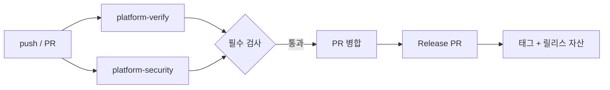

# dev-platform 사용설명서

매일 쓰는 절차만 모았다. 명령 레퍼런스는 [VERIFY.md](VERIFY.md), 새 저장소 연결은 [ADOPTION.md](ADOPTION.md), 플랫폼 자체를 고치는 방법은 [MAINTAINING.ko.md](MAINTAINING.ko.md)에 있다.

## 1. push하면 무엇이 자동으로 일어나는가

push나 PR에서 `platform-verify`와 `platform-security`가 동시에 시작된다. 둘은 서로를 기다리지 않으므로 결함이 있으면 두 검사가 같이 빨간색이 된다. `platform-verify`는 `.devplatform/config.json`의 프로필에 따라 `quality.yml`(Python/TypeScript/.NET) 또는 `unity.yml`(Unity)을 호출하고, `platform-security`는 trivy·gitleaks·zizmor·actionlint를 돌린다. `main`에 병합되면 release-please가 Release PR을 열고, 그 PR이 병합되면 태그와 릴리스 자산이 만들어진다. 병합 가능 여부는 ruleset `platform-gates`의 필수 검사가 결정한다.



## 2. 매일 하는 일

### 2.1 commit

`bootstrap` 또는 `devctl init`이 pre-commit 훅을 설치한다. 훅은 staged 파일만 검사하고 Unity 에디터를 실행하지 않는다.

| 프로필 | 훅이 실행하는 것 |
| --- | --- |
| `python` | staged `.py`에 `ruff check`, `ruff format --check` |
| `typescript` | staged 파일에 `eslint --max-warnings=0`, `prettier --check` |
| `dotnet` | staged `.cs`에 `dotnet format --verify-no-changes --include` |
| `unity`, `unity-assets` | `Assets/`, `Packages/`, `ProjectSettings/` 변경 시 `unity integrity` |

막히면 `[FAIL] hooks-ruff-check (exit 1, 0.31s)` 같은 줄과 도구 출력의 마지막 20줄이 보인다. 전체 로그는 `artifacts/reports/<profile>/hooks-ruff-check.log`처럼 단계 이름으로 남는다. 손으로 다시 돌리거나, dev-platform 경로를 옮겨 훅을 다시 설치할 때:

```bash
uv run --project C:/dev/dev-platform/cli devctl hooks pre-commit
uv run --project C:/dev/dev-platform/cli devctl hooks install
```

`--no-verify`로 건너뛸 수는 있지만 CI가 같은 검사를 더 넓게 실행하므로 실패를 미루는 것뿐이다.

### 2.2 push하고 결과 보기

```bash
git push -u origin HEAD
gh run list -L 5
gh run view <run-id> --log-failed
gh pr checks <pr-number>
```

필수 검사 이름은 저장소마다 다르다.

| 저장소 | 필수 검사 |
| --- | --- |
| `dev-flow-py`, `dev-flow-web` | `platform-verify / verify`, `platform-security / scan` |
| `project-delta` | `platform-verify / integrity`, `platform-verify / tests`, `platform-security / scan` |
| `dev-platform` | `cli`, `templates (python)`, `templates (typescript)`, `templates (dotnet)`, `templates (unity)`, `workflow-lint`, `security / scan` |

### 2.3 실패 이슈(`ci-alert`)

실패하면 `notify` 작업이 `ci-alert` 라벨의 이슈를 만들거나 같은 제목의 열린 이슈에 코멘트를 단다. 본문에는 워크플로, 작업, 커밋, 실행 URL, 실패한 단계와 로컬 재현 명령이 들어 있다. 이슈는 자동으로 닫히지 않으므로 수정이 `main`에 들어간 것을 확인하고 직접 닫는다. 다음 실패는 새 이슈가 아니라 같은 이슈에 코멘트로 붙는다.

```bash
gh issue list --label ci-alert
cd C:/dev/project-delta
uv run --project C:/dev/dev-platform/cli devctl verify --profile unity
```

마지막 명령이 이슈에 적힌 `devctl verify --profile unity`의 전체 형태다. 파이프라인에는 Copilot/AI가 연결돼 있지 않으므로, 이 명령을 로컬 편집기(omp 포함)에서 그대로 실행해 고친다.

## 3. 로컬 검증 명령

로컬과 CI는 같은 `devctl verify`를 같은 인자로 실행한다. 저장소 루트에서 실행하고 `C:/dev/dev-platform`은 clone 위치에 맞게 바꾼다.

| 프로필 | 명령 | 산출물 |
| --- | --- | --- |
| `python` | `devctl verify --profile python` | `artifacts/reports/python/`의 `summary.json`, `coverage.xml`, `junit.xml` |
| `typescript` | `devctl verify --profile typescript` | `artifacts/reports/typescript/`, `coverage/coverage-final.json` |
| `dotnet` | `devctl verify --profile dotnet` | `artifacts/reports/dotnet/`의 `coverage.cobertura.xml`, `test.trx` |
| `unity` | `devctl verify --profile unity` | `artifacts/reports/unity/`, `artifacts/reports/unity/coverage/Report/Summary.xml` |
| `unity-assets` | `devctl verify --profile unity-assets` | `artifacts/reports/unity-assets/` |

`unity-assets`는 무결성만 검사한다. 실제 호출은 다음처럼 `uv`로 감싼다.

```bash
uv run --project C:/dev/dev-platform/cli devctl verify --profile unity-assets
uv run --project C:/dev/dev-platform/cli devctl summary
```

모든 프로필의 reports 디렉터리에는 `summary.json`, `summary.md`, 단계별 `<step>.log`가 함께 남는다. `verify`는 시작할 때 `<reports>/<profile>/`를 비우므로 이전 실행의 로그는 남지 않는다. 선행 단계가 실패하면 그 단계에 의존하는 단계는 실패가 아니라 `skipped`가 되고 `detail`에 `prerequisite <name> failed`가 기록된다(예: `pytest` 실패 시 `coverage`).

종료 코드는 계약이다. 0은 통과, 1은 게이트 실패(린트·테스트·커버리지·무결성), 2는 전제조건 없음(에디터·토큰·깨끗한 git 상태), 3은 실행 실패(도구 오류·결과 파일 없음), 4는 요구 기능 없음(예: `--require-odin`)이다. 기본 동작은 모든 단계를 끝까지 실행하고 실패를 모으는 것이다. 첫 실패에서 멈추려면 `--fail-fast`, 커버리지 하한을 덮으려면 `--min-coverage <n>`을 붙인다.

## 4. Unity

### 4.1 러너가 하는 일

`project-delta`의 `platform-verify`는 `unity.yml`을 호출한다. `changes` 작업이 `Assets/`, `Packages/`, `ProjectSettings/` 변경을 비교하고, `integrity`는 GitHub 호스팅 러너에서 `unity-assets` 검사를 항상 돌린다. 이 PC의 self-hosted 러너가 `tests` 작업에서 `devctl verify --profile unity`를 실행한다. Unity 관련 변경이 없으면 `::notice::no Unity-relevant changes`만 남기고 초록으로 끝난다. 테스트 작업은 `concurrency: unity-<repo>`로 한 번에 하나만 돈다. Unity 에디터가 프로젝트를 잠그기 때문이다.

### 4.2 PC를 켜 두기

러너는 로그온 시 Startup 폴더의 스크립트로 시작한다. PC가 꺼져 있으면 작업은 큐에 남고 GitHub은 최대 24시간까지 기다린 뒤 취소한다. 테스트가 필요한 push라면 그 전에 PC를 켠다.

```bash
gh api repos/ghdtmdwns133/project-delta/actions/runners --jq '.runners[] | {name, status, busy}'
gh run list --status queued -L 5
```

`status`가 `online`이면 정상이다. 러너의 `bash`는 WSL bash로 해석되므로 self-hosted 작업은 `pwsh`로 실행된다. 재시작과 중지는 `C:/ghr/README.txt`의 명령을 쓰고, 시작 로그는 `C:/ghr/runner/_diag/`에 있다. 큐에 남은 실행은 `gh run cancel <run-id>`로 정리한다.

```bat
start "" /min C:\ghr\runner\run.cmd
powershell -c "Get-Process Runner.Listener,Runner.Worker -EA 0 | Stop-Process"
```

### 4.3 PlayMode 켜기와 끄기

`project-delta`는 지금 EditMode만 돈다. `.devplatform/config.json`의 `unity.testPlatforms`에 `"PlayMode"`를 넣으면 켜진다.

```json
"testPlatforms": ["EditMode", "PlayMode"]
```

PlayMode는 `unity.playmodeMode`가 `"gui"`라서 에디터 창을 열고 데스크톱에 입력을 주입한다. 실행 중에는 마우스와 키보드를 건드리지 않는다. 창이 떠 있는 동안 다른 Unity 작업을 시작하면 잠금 때문에 exit 2로 실패한다. 다시 EditMode만 쓰려면 배열에서 `"PlayMode"`를 빼고 커밋한다.

### 4.4 빌드가 도는 시점

기본 검증에는 빌드가 없다. nightly(`.github/workflows/nightly.yml`이 `build: true`로 호출할 때)와 릴리스가 만들어질 때(`release.yml`의 `build` 또는 `build-cloud`)만 돈다. 로컬에서는 `--unity-build`로 확인하고, 성공 조건은 exit 0, exe 존재, 출력 디렉터리 전체 크기 1 MiB 초과다. 결과는 `artifacts/unity-build/ProjectDelta.exe`다.

```bash
uv run --project C:/dev/dev-platform/cli devctl verify --profile unity --unity-build
```

### 4.5 로컬 실행 뒤 생기는 churn

에디터를 열면 Unity가 에셋을 다시 직렬화해 커밋과 무관한 변경이 생긴다. `project-delta`에서는 폰트 에셋이 대표적이다. 이런 변경은 커밋하지 않는다.

```bash
git status --short
#  M "Assets/Prototype/Fonts/NotoSansKR SDF.asset"
git restore "Assets/Prototype/Fonts/NotoSansKR SDF.asset"
```

`Packages/packages-lock.json`이 바뀌었다면 패키지를 실제로 바꾼 경우이므로 내용을 확인하고 함께 커밋한다.

## 5. 릴리스

### 5.1 conventional commit

release-please는 커밋 메시지로 버전을 정한다.

| 메시지 | 결과 |
| --- | --- |
| `fix: correct critical path order` | patch |
| `feat: add stage validation` | minor |
| `feat!: drop legacy profile` 또는 본문에 `BREAKING CHANGE:` | major |
| `docs:`, `chore:`, `ci:`, `test:` | 릴리스 노트에만 반영 |

### 5.2 Release PR에서 태그까지

1. `main` push, 매일 04:23 schedule(`23 4 * * *`), 수동 dispatch 중 하나로 `release.yml`이 시작되고 release-please가 Release PR을 만들거나 갱신한다. `release-please-config.json`의 `always-update: true`가 PR을 `main` 위로 계속 rebase한다.
2. 워크플로가 PR에 `automerge` 라벨을 붙이고 `gh pr merge --auto --squash`를 건 뒤 Release PR 브랜치로 CI를 dispatch한다.
3. `GITHUB_TOKEN`으로 만든 PR의 CI는 `action_required`로 시작한다. 잡이 `gh api -X POST repos/ghdtmdwns133/<repo>/actions/runs/<id>/approve`로 그 실행을 승인하고, 최대 `merge-wait-minutes`(기본 15) 동안 병합을 기다린다.
4. 병합되면 기본 브랜치를 다시 checkout해 release-please를 한 번 더 실행한다. 같은 실행에서 `release_created`가 true가 되고, build 작업이 태그(`tag_name`)를 checkout해 자산을 만든 뒤 publish가 릴리스에 붙인다.
5. 대기 시간을 넘기면 `::notice::`만 남기고 성공으로 끝난다. 릴리스는 다음 push나 다음 schedule에서 만들어진다. `merge-wait-minutes: 0`은 대기를 끄며, `project-delta`는 private 저장소의 유료 대기 시간을 피하려고 0을 쓴다. `workflow_run`(CI completed) 트리거도 남아 있어, 신뢰된 액터가 시작한 CI 재실행에서는 Release PR을 직접 병합한다.

자산은 `dev-flow-py`가 wheel/sdist, `dev-flow-web`이 `dist.zip`, `project-delta`가 빌드 명령이 만드는 `ProjectDelta.zip`이다.

### 5.3 Unity 빌드 자산의 출처

self-hosted 경로는 `runs-on: '["self-hosted","windows","unity"]'`에서 빌드하므로 PC가 켜져 있어야 한다. `UNITY_BUILD_API_KEY`, `UNITY_BUILD_ORG_ID`, `UNITY_BUILD_PROJECT_ID` 세 시크릿이 모두 있으면 `build-cloud` 작업이 Unity Build Automation에서 빌드하고, 없으면 self-hosted 경로로 떨어진다. UBA는 대시보드에서 저장소 연결과 Windows build target 생성이 한 번 필요하고, target id와 API key를 위 시크릿에 넣는다.

PC가 꺼져 있을 때는 UBA로 수동 빌드한다. 결과는 `unity-cloud-build` 아티팩트와 `artifacts/reports/unity/cloud-build.json`(빌드 번호, 커밋, SHA-256, 빌드 URL)에 남는다. 아래 로컬 명령은 `UNITY_BUILD_*` 환경변수가 있을 때만 동작한다.

```bash
gh workflow run cloud-build.yml -R ghdtmdwns133/project-delta -f ref=main
uv run --project C:/dev/dev-platform/cli devctl unity cloud-build --commit <sha> --target <target-id>
```

UBA 무료 한도는 Windows 200분/월이고, 소진되면 결제 수단이 없는 한 빌드가 멈춘다. 설정은 [UNITY-CI.md](UNITY-CI.md)에 있다.

### 5.4 릴리스 자산만 다시 빌드

릴리스는 만들어졌는데 자산 빌드가 실패했으면(PC 꺼짐, 러너 오프라인) `rebuild-tag`로 같은 태그를 다시 빌드한다. release-please, 자동 병합, 병합 대기는 모두 건너뛰고, 해당 태그를 기준으로 빌드한 뒤 자산을 `--clobber`로 교체한다. 릴리스가 없으면 실행이 exit 1로 실패한다.

```bash
gh workflow run release.yml -R ghdtmdwns133/project-delta --ref main -f rebuild-tag=project-delta-v0.1.0
```

## 6. Dependabot PR

Dependabot은 주 1회, 생태계별로 묶어 PR을 연다. minor와 patch는 한 PR, major는 별도 PR이고 열린 PR 상한은 5개다. 자동 병합은 `auto-merge.yml` caller가 있는 저장소에서 `dependabot[bot]`의 patch/minor PR, 또는 소유자나 `github-actions[bot]`이 만들고 `automerge` 라벨이 붙은 PR에 걸린다. 실제 병합은 필수 검사 통과가 조건이다. major PR, 런타임 동작이 바뀌는 patch, Unity 패키지 major는 직접 읽고 병합한다.

`project-delta`에는 `github-actions` 생태계만 설정돼 있고 auto-merge caller가 없으므로 직접 병합한다.

```bash
gh pr list --author "app/dependabot" -L 10
gh pr view <number>
```

## 7. 새 프로젝트 시작

```bash
uv run --project C:/dev/dev-platform/cli devctl init \
  --template python --name my-service --dest C:/dev/my-service
cd C:/dev/my-service
uv run --project C:/dev/dev-platform/cli devctl verify --profile python
```

`init`은 `_shared`와 템플릿을 합쳐 렌더링하고, 미치환 토큰이 남으면 아무것도 만들지 않고 중단한다. 빈 디렉터리가 아니면 `--force` 없이는 실패한다. 새 디렉터리에서는 git 저장소와 pre-commit 훅까지 만든다. 결과에는 `.devplatform/config.json`, caller 워크플로(`ci.yml`, `nightly.yml`, `release.yml`, `auto-merge.yml`), dependabot, release-please 설정, devcontainer, 소유자가 치환된 루트 `zizmor.yml`이 들어 있다. 원격 연결과 ruleset은 [ADOPTION.md](ADOPTION.md)를 따른다.

## 8. 비용과 한도

| 항목 | 한도 | 넘으면 |
| --- | --- | --- |
| GitHub Actions, private | 3,000분/월 (GitHub Pro 학생) | 결제 수단이 없으면 실행 중지 |
| GitHub Actions, public | 무료 | — |
| 아티팩트·캐시 | 아티팩트 1 GB, 캐시 저장소당 10 GB | 저장 한도 초과 |
| Unity Build Automation | Windows 200분/월 | 빌드 중지(카드 등록 시 과금) |
| Codecov, private | 업로드 250회/월 | 업로드 한도 소진 |
| Sentry, Education | 조직 Subscription 화면 값이 정본 | 한도 소진 |

사용량은 `user` 스코프를 한 번 갱신한 뒤 조회한다. 예산과 "Stop usage" 설정은 UI에서만 바꾼다: `https://github.com/settings/billing/budgets`. 통제 항목은 [COSTS.md](COSTS.md).

```bash
gh auth refresh -h github.com -s user
gh api /users/ghdtmdwns133/settings/billing/usage/summary
```

## 9. 자주 막히는 상황

**PR에 체크가 하나도 안 뜬다.** `docs/**`와 `**/*.md`만 바꾼 PR은 caller의 `paths-ignore` 때문에 CI가 시작되지 않는다. 코드를 한 줄이라도 섞거나 소유자 권한으로 병합한다. 초안 PR도 검사가 붙지 않는다.

**실행이 `action_required`로 멈춰 있다.** 포크나 첫 기여자의 PR은 워크플로 승인이 필요하다. release PR은 release 잡이 스스로 승인한다. API가 거부하면 PR 화면의 **Approve and run workflows**를 쓴다.

```bash
gh api -X POST repos/ghdtmdwns133/<repo>/actions/runs/<run-id>/approve
```

**`platform-verify / tests`가 계속 queued다.** 러너가 꺼져 있거나 오프라인이다. 4.2의 상태 확인으로 `online`인지 보고, 아니면 러너를 시작한다. 필요 없으면 `gh run cancel <run-id>`로 정리한다.

**gitleaks가 예전 비밀 때문에 계속 빨간색이다.** gitleaks는 `fetch-depth: 0`으로 전체 히스토리를 스캔한다. 먼저 비밀을 폐기하고 새 값으로 교체한다. 그 커밋이 `main` 히스토리에 없다면 브랜치를 삭제해 스캔 대상에서 빼면 되지만, `main`에 들어갔다면 히스토리를 재작성하지 않는 한 계속 잡힌다.

**`unity-coverage` 단계만 실패한다.** `coverage.minimum`보다 측정값이 낮다. `summary.json`의 `coverage.line`을 확인하고 테스트를 보강하거나 하한을 근거와 함께 조정한다. 리포트 자체가 없으면 실패가 아니라 경고다.

**Unity 검증이 exit 2로 끝난다.** 에디터를 찾지 못했거나(`Unity 6000.5.1f1 editor not found`), 에디터가 이미 실행 중이다(`Unity editor is running`). 에디터를 닫고 다시 실행하고, 버전이 다르면 `unity.version`과 `ProjectSettings/ProjectVersion.txt`를 맞춘다.

**릴리스는 생겼는데 자산이 없다.** 자산 빌드만 실패한 경우다. `gh workflow run release.yml -R ghdtmdwns133/<repo> --ref main -f rebuild-tag=<tag>`로 그 태그를 다시 빌드하면 자산이 교체된다(5.4).

**릴리스가 바로 생기지 않는다.** release-please가 만든 PR은 `GITHUB_TOKEN` 때문에 CI가 `action_required`로 시작하고, release 잡이 이를 승인한 뒤 `merge-wait-minutes`(기본 15)까지 기다린다. 시간이 지나면 notice만 남기고 성공으로 끝나며, 릴리스는 다음 push나 04:23 schedule에서 만들어진다. `merge-wait-minutes: 0`인 `project-delta`는 처음부터 다음 트리거를 기다린다. 막힌 체크는 `gh pr checks <number>`로 확인한다.
